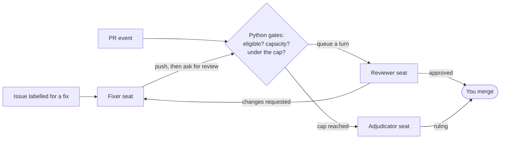

<p align="center"></p>

# Diaktoros

**Bounded, autonomous software maintenance for Hermes.**

Diaktoros is a Hermes plugin that keeps a repository moving while you're away. One agent reviews pull requests; another fixes what it finds. New issues are triaged and small ones fixed automatically, red CI goes to the fixer first, a watchdog reports stalls, disputes go to an adjudicator, and rounds are capped. Deterministic Python, not a model, controls eligibility, capacity, retries and escalation. **The loop never merges.**

**Start here:** [Project site](https://coe0718.github.io/diaktoros/) · [Getting started](docs/getting-started.md) · [How it works](docs/concepts.md) · [Documentation map](docs/README.md) · [Commands](docs/commands.md)

## Why it exists

Coding agents now open pull requests faster than people can review them, and an agent that reviews and merges its own work is a liability, not a teammate. Diaktoros puts agents to work on a repository under rules a maintainer can read and audit:

- **Bounded.** Every PR gets a fixed number of review verdicts (3 by default). At the cap the PR stops and goes to an adjudicator or to you. Daily token and turn budgets cap each seat's spend.
- **Separated.** The reviewer and the fixer are distinct GitHub accounts (or GitHub Apps) running distinct Hermes profiles, so the account that writes a fix never reviews it. No seat can merge.
- **Contained.** Every agent turn runs in a bubblewrap sandbox with no GitHub token, no model key and no direct network. The host brokers each write and rechecks the live PR before sending it.
- **Accountable.** Every turn and its outcome is recorded in a local run ledger. `hermes dk explain` says why a PR is stuck and what has to happen next; `hermes dk stats` says what the loop did and what it cost.

## It maintains itself

Diaktoros runs on its own repository. Between the v0.5.0 release (October 26, 2026) and November 9, 2026:

| | |
| --- | --- |
| **328** pull requests merged | **229** of them opened by the loop's fixer seat ([`drey-coe1`](https://github.com/coe0718/diaktoros/pulls?q=is%3Apr+is%3Amerged+author%3Adrey-coe1)), each fixing an issue |
| **327** of the 328 reviewed by its reviewer seat ([`vex-coe`](https://github.com/coe0718/diaktoros/pulls?q=is%3Apr+is%3Amerged+reviewed-by%3Avex-coe)) | **264** of the 439 new issues filed by the loop's own accounts (the reviewer seat and the reader) |

The loop merged none of them: every merge came from the maintainer's account. The counts are GitHub search results, and the links above re-run them.

### One PR, start to finish

[#1988](https://github.com/coe0718/diaktoros/pull/1988) shows the whole loop. Every commit in it was written by the fixer seat:

1. Issue [#1362](https://github.com/coe0718/diaktoros/issues/1362), a `P3` bug, is labelled `agent-fix`, which hands it to the fixer seat.
2. The fixer opens #1988 from a `diaktoros/issue-1362` branch. CI goes red on a file handle a test leaked; the fixer repairs CI before the reviewer spends a verdict, and says how in a comment.
3. The reviewer requests changes with numbered findings, each cited to a line in the diff. The fixer answers every finding and pushes a new head. That happens twice.
4. The third change request reaches the cap (3 of 3). The adjudicator checks each finding against the code at that head, rules **ACCEPT** because the one finding left is a gap in the review's evidence rather than a defect, approves the head and dismisses the overruled request.
5. The maintainer merges.

## How it works



1. A GitHub webhook reaches your Hermes gateway. A **gate** script reads live GitHub state and decides, in plain Python, whether the event earns a turn. It answers `[SILENT]`, so no ordinary credential-owning Hermes agent handles the event.
2. A host **worker** claims the queued turn, rechecks the PR at its exact head, exports that head and starts the seat in bubblewrap.
3. The seat reads, builds and tests inside the sandbox. Model calls go through a bounded inference capability. GitHub writes go through the host **broker**, which allows each seat only its own bounded writes (the reviewer one review, the fixer one push and its answers, the adjudicator one ruling) and rechecks the PR before sending them.
4. The **watchdog**, a scheduled job and not an agent, reports stalls, drains queued work and repairs the loop's own routes.

[Concepts](docs/concepts.md) defines each piece; [Architecture](docs/architecture.md) shows how the gates, ledgers and reconciliation fit together.

## Safety model

> With a valid private `diaktoros-runtime.json` and hooks activated by `arm`, an eligible reviewer turn posts a real GitHub review. Gates answer `[SILENT]` so a normal credential-owning gateway agent does not handle the event. Agents run in bubblewrap without GitHub/model credentials or direct network access; host processes provide bounded inference and broker writes. Unattended fixer pushes stay **off** until the host operator explicitly runs `hermes dk fixer-push --loop ID --enable --acknowledge-pr-race`. A Git ref lease cannot atomically enforce GitHub PR metadata: the PR can close or retarget between the final API check and push. Read the [security boundary and push policy](docs/security.md) before opting in. No seat can merge; uncertain writes are not automatically replayed.

Isolation is not immunity: installed plugins are trusted host code, and a kernel or bubblewrap escape would run as the host user. Offline tests do not establish provider-policy approval or live credentials. Issue triage, issue fixing and the Desktop forms have offline coverage, not a claimed live acceptance test here. See [Security](docs/security.md) and [Development](docs/development.md).

## What it does

Every capability below is on `main` and driven by the command named beside it. Run `hermes dk <command> --help` for the exact flags; [`docs/commands.md`](docs/commands.md) is the full reference.

| Capability | What happens | Command |
| --- | --- | --- |
| **Review** | An isolated reviewer posts a real GitHub review at the exact head | hooks, or `hermes dk review` |
| **Fix** | The fixer answers the findings on the PR branch | hooks, or manual |
| **Issue triage** | New issues are classified; small ones are fixed | `hermes dk triage` |
| **CI repair** | Red CI goes to the fixer before the reviewer spends a verdict | `hermes dk set` |
| **Affected tests** | The fixer runs only the tests its change touches | `hermes dk set` |
| **Change proof** | Off until turned on: before each review the host runs the PR's new or changed Python `unittest` tests on its merge base, where they should fail, and at the head, where they should pass, and tells the reviewer which it found ([Change proof](docs/change-proof.md)) | `hermes dk set --change-proof on` |
| **Rounds and the cap** | Verdicts are counted; at the cap the PR escalates | built in |
| **Adjudication** | A dispute goes to an adjudicator for a ruling | `hermes dk escalate` |
| **Shadow review** | Off until a shadow profile is set: a second model reviews the same head in no-write mode and posts nothing; where it disagrees with the real review is recorded | `hermes dk set --shadow-profile`, then `hermes dk report` |
| **Stalls** | A watchdog reports sleeps, drains queued work, repairs owned routes | scheduled job |
| **Merge readiness** | Open PRs that are safe to merge, in a safe order | `hermes dk ready` |
| **History** | Seat turns, timings, verdicts and cost over a window | `hermes dk stats` |
| **Why a PR is stuck** | The current gate, and what has to happen next | `hermes dk explain` |
| **Re-arm a failed run** | Retry a run that failed before writing anything | `hermes dk retry` |
| **Stop a run** | Cancel a queued, blocked, waiting or running run; only a retry re-arms it | `hermes dk cancel` |
| **Queue** | A queued run starts once its seat frees | `hermes dk drain` |
| **Disk** | Local review artifacts for merged or closed PRs are reclaimed | `hermes dk cleanup` |
| **Backup and restore** | One private archive of everything the plugin owns | `hermes dk backup`, `hermes dk restore` |
| **Desktop** | An optional page and status-bar item in Hermes Desktop | Desktop -> Capabilities |
| **Notices** | An optional observer feed posts transitions to a chat | [Observer](docs/observer.md) |
| **Diagnosis** | Preflight, live-path selftest, and a webhook dry-run | `hermes dk doctor`, `hermes dk selftest`, `hermes dk trace` |
| **Regression replay** | Historical PRs with known problems, run end to end | `hermes dk corpus` |

## Before you start

- Linux with working bubblewrap (`bwrap`) and unprivileged user namespaces. Native macOS turns are not supported; run Hermes and the plugin inside Linux instead.
- Hermes **>=0.21.5** (manifest requirement), a Hermes Git checkout and working virtualenv, Python runtime and Rust toolchain for the isolated runtime. A version number alone does not prove sandbox/provider compatibility: run `selftest`.
- Your own HTTPS-reachable Hermes gateway, and a repository whose hooks you can administer.
- Separate reviewer and fixer Hermes profiles; three distinct GitHub accounts and token files: reader, reviewer and fixer. An adjudicator comment account is optional and must be distinct too. Or run each role as a GitHub App, with no personal account or PAT: see [Getting started with GitHub Apps](docs/github-apps.md).

[Accounts and permissions](docs/accounts.md) explains which token each role needs. See the [Hermes documentation](https://hermes-agent.nousresearch.com/docs) for Hermes installation, profiles, model authentication and gateway setup.

## Install

Replace quoted angle-bracket placeholders before running examples. `ID` is the installed loop id; `N` is a PR number. No shared webhook host is provided.

```bash
hermes plugins install diaktoros
hermes dk setup --repo "<owner>/<repository>"
```

`hermes dk` is short for `hermes diaktoros`; either works. Coming from hermes-review-loop? See [Upgrading from hermes-review-loop](#upgrading-from-hermes-review-loop).

The plugin is in the [Hermes plugin catalog](https://github.com/NousResearch/hermes-agent/tree/main/plugin-catalog), so `hermes plugins install diaktoros` installs the reviewed release at its pinned commit. Desktop can install it from the catalog too. Catalog updates arrive only through a reviewed pin bump.

The install scanner rates the plugin **caution**. A catalog install accepts that without a prompt, because the catalog reviewed it at admission. Typical findings concern subprocess execution (`bwrap`, Git, workers and test fixtures), security-probe code, and setup advice mentioning privileged commands. A caution verdict is not a security audit. To update, run `hermes plugins update diaktoros`: it moves to the commit the catalog has reviewed.

`setup` detects runtime paths, previews `init`, installs the requested wiring, schedules the watchdog and runs `doctor` plus `selftest --no-model`. It asks before arming; **decline arming until ready**. Name a hook admin to create paused hooks. If that answer is blank and hooks are absent, `doctor` fails and setup prints **stopped before arming**, exiting 1; that is expected until you create the hooks manually. Re-running setup on an existing loop keeps its saved settings; use `set` or `apply` to change them.

The [complete onboarding guide](docs/getting-started.md) includes a reproducible noninteractive setup and a flag-by-flag `init` alternative. To preview explicit wiring instead of the wizard:

```bash
hermes dk init \
  --repo "<owner>/<repository>" \
  --fixer "<fixer-login>" --reviewer "<reviewer-login>" \
  --fixer-profile "<fixer-profile>" --reviewer-profile "<reviewer-profile>" \
  --read-token "<reader-login>" \
  --token "<reader-login>=~/.hermes/keys/<reader-login>-pat" \
  --token "<reviewer-login>=~/.hermes/keys/<reviewer-login>-pat" \
  --token "<fixer-login>=~/.hermes/keys/<fixer-login>-pat" \
  --host "https://<gateway-host>" --dry-run
```

| Option | What it does |
| --- | --- |
| `--repo` | Repository to review; the repository component becomes the default loop id |
| `--fixer`, `--reviewer` | Distinct GitHub logins admitted for the two roles |
| `--fixer-profile`, `--reviewer-profile` | Existing, distinct Hermes profiles used to run the seats |
| `--read-token` | Third GitHub login for trusted reads, not the token itself |
| Repeated `--token` | `LOGIN=PATH` mappings to separate private PAT files; the plugin expands `~` |
| `--host` | Your gateway origin, without a path |
| `--dry-run` | Validate and preview without writing; does not prove live token permissions |

This minimal preview does not install repository hooks, a watchdog schedule or the runtime file. Use the [annotated complete installation](docs/getting-started.md#b-explicit-init-for-controlled-wiring) before expecting turns to run.

### First run, in order

For a loop already installed with paused hooks:

```bash
# setup writes $HERMES_HOME/diaktoros-runtime.json; init alone does not.
hermes dk doctor --loop ID
hermes dk selftest --loop ID --no-model
hermes dk selftest --loop ID --pr N
hermes dk selftest --loop ID --pr N --live-turn
hermes dk arm --loop ID
```

`--no-model` skips inference, **not GitHub reads**. The next two selftests spend model quota; the live-turn verdict is printed, not posted. `N` must be an eligible open, non-draft, same-repository PR targeting the loop's base. `arm` activates existing matching hooks and sends a GitHub ping to every hook—a GitHub write—using the reader's token unless `--admin-token "<admin-login>"` is supplied. It exits 1 if a ping is rejected; inspect the output and hook state before continuing. Full checks and their limitations: [Verify and arm](docs/getting-started.md#verify-and-arm).

### Then watch it work

Open a PR from the fixer's allowlisted account, or label an issue for the fixer once [issue fixes](docs/issues.md) are on. Then:

```bash
hermes dk status --loop ID
hermes dk explain --loop ID --pr N
hermes dk stats --loop ID
```

`status` shows the loop's seats, routes, pacing and queued or running turns. `explain` names the gate a PR is waiting on and what happens next. `stats` totals turns, verdicts, timings and cost. Two opt-ins make each review stronger: [change proof](docs/change-proof.md), which proves a PR's tests fail without its change, and a [shadow review](docs/configuration.md#shadow-reviews) from a second model.

```bash
hermes dk set --loop ID --change-proof on
```

## Upgrading from hermes-review-loop

Diaktoros was called hermes-review-loop before v0.2.0. **Hermes knows a plugin by its name, and the name changed.** Installing Diaktoros puts it in a new folder, `diaktoros`, beside your `hermes-review-loop`. It isn't enabled until you enable it under its new name. Your loops keep running through the old plugin until `migrate` points them at the new one. Between turns:

```bash
hermes plugins disable hermes-review-loop        # the old plugin; its gates keep running by path until migrate
hermes plugins install diaktoros                 # from the catalog, at its reviewed commit
hermes plugins enable diaktoros
hermes dk migrate --dry-run                      # what moves: settings, file names, the watchdog job
hermes dk migrate                                # add --rename-loop OLD=NEW --admin-token LOGIN to rename a loop
hermes dk doctor                                 # green? then:
hermes plugins remove hermes-review-loop
```

`hermes review-loop` was removed in v0.6.0: use `hermes dk`. [Operations](docs/operations.md#upgrading-from-hermes-review-loop) has the details.

## Advanced: Claude subscription seats (DirectSDK)

The experimental `claude-subscription-directsdk-experimental` provider runs its native client on the trusted host. Seat GitHub/model credentials still stay outside bubblewrap; model requests cross a bounded per-run inference capability. Native authentication defaults to the OS user's login: distinct Hermes profiles alone do not create separate subscriptions. Configure explicit host-side native account directories if different accounts are required. This integration is not provider-policy approval, and offline tests do not prove native prerequisites or a live completion. See [configuration](docs/configuration.md) and [security](docs/security.md) before selecting it.

## Run and extend

| Need | Read or run |
| --- | --- |
| Understand seats, rounds and handoffs | [Concepts](docs/concepts.md) |
| Inspect an installed loop | `hermes dk status --loop ID` |
| Explain one stuck PR without changing it | `hermes dk explain --loop ID --pr N` |
| Pause existing hooks | `hermes dk arm --loop ID --pause` |
| Add issue triage or maintainer-triggered fixes | [Issues](docs/issues.md) — opt-in |
| Prove a PR's tests fail without its change | [Change proof](docs/change-proof.md) — opt-in |
| Receive transition notices without another agent | [Observer feed](docs/observer.md) — opt-in |
| Change defaults, identities or limits | [Settings](docs/settings.md) and [configuration](docs/configuration.md) |
| Operate, diagnose or contribute | [Operations](docs/operations.md), [troubleshooting](docs/troubleshooting.md), [development](docs/development.md) |

## License

MIT. See [LICENSE](LICENSE).
